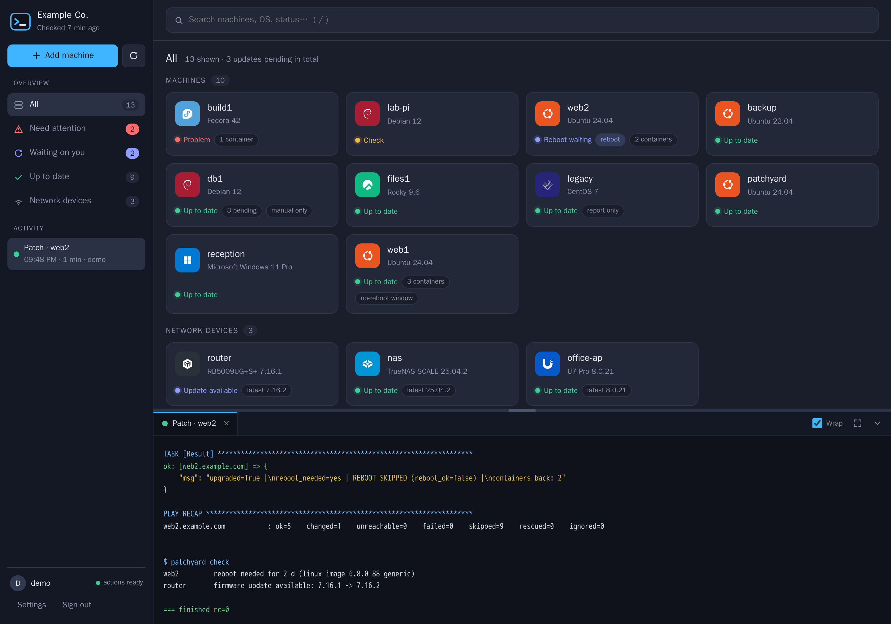

<div align="center">


# Patchyard

**`>_` Where your fleet gets patched, so you don't have to think about it.**

[](LICENSE)
[](https://www.python.org/)
[](pyproject.toml)
[](https://www.ansible.com/)
[](#-manage-it-from-an-ai-assistant-mcp)

</div>

> [!IMPORTANT]
> **The mission:** nobody should ever spend hours of their life, added up over months, worrying about
> patching and keeping updates current across their network. Set Patchyard up once; after that,
> updates happen by themselves and you only decide **when to reboot**.

<p align="center">
  
  <br><sub>Made-up machines from the built-in demo. See it yourself in ten seconds: <code>python3 -m patchyard demo</code></sub>
</p>

---

## ✨ What you get

| | |
|---|---|
| 🔄 **Daily automatic updates** | Every machine updates itself, every day. **Nothing ever reboots on its own**: that stays your call. |
| 🖥️ **One dashboard** | Up to date, waiting for a reboot, update available, broken, stopped containers. Everything at a glance, plus a live terminal for every job. |
| 🖱️ **One-click actions** | Patch, reboot (one machine at a time, waiting for its containers to come back), release upgrades without a terminal, watch or cancel a running upgrade. |
| ➕ **Add machines from the browser** | Type a name and an admin password once, or paste one command. Patchyard creates its own locked-down account and takes it from there. |
| 📡 **Network gear too** | Routers, firewalls, access points, NAS boxes: firmware checks, updates and reboots through their own APIs. |
| 🔔 **Quiet alerts** | Push (ntfy), webhook or e-mail, only for *new* problems, plus one daily reminder while something waits on you. |
| 🧙 **Setup wizard** | Five minutes in the browser. Works with **local accounts only** or with **your domain** (Active Directory, FreeIPA, any Kerberos realm). |
| 🤖 **AI assistant ready** | A built-in MCP server: ask Claude (or any MCP client) *"what needs a reboot?"* and let it patch with your confirmation. |
| 🪶 **Tiny footprint** | Standard-library Python, no database, no build step, no agents on your machines (just SSH). |

## 🚀 Quick start

You need one Linux machine with systemd and Python 3.11+ to run Patchyard (the *controller*).

> [!NOTE]
> **Just looking?** Any machine with Python 3.11+ runs the dashboard with made-up machines; nothing
> is installed or contacted:
> `git clone https://github.com/aduclos/patchyard.git && cd patchyard && python3 -m patchyard demo`,
> then open <http://127.0.0.1:8790/>.

**1. Install**

```sh
sudo git clone https://github.com/aduclos/patchyard.git /srv/patchyard
cd /srv/patchyard
python3 -m venv /tmp/py && /tmp/py/bin/pip install ansible-core      # only to run the installer
sudo /tmp/py/bin/ansible-playbook install/controller.yml
```

When it finishes it prints something like:

```
Patchyard is running. Open http://192.0.2.5:8790/ and enter the setup code: 3f9a1c-77b20e-c41d55
```

**2. Open that address and follow the wizard**: name your site, pick how people sign in, choose
where alerts go. Done.

**3. Press ➕ Add machine** for each computer. That's the last time you think about patching it.

> [!TIP]
> Rather keep everything as code? Skip the wizard with
> `-e patchyard_config_file=/path/to/patchyard.toml` (all keys are documented in
> [`config/patchyard.example.toml`](config/patchyard.example.toml)).

## 🧙 Sign-in: your choice

The wizard asks once; you can switch later in the configuration file.

| Option | Best for | What you need |
|---|---|---|
| 👤 **Patchyard accounts** *(default)* | Home labs, small offices, anything without a directory | Nothing. Create the first admin in the wizard, more in **Settings → Users**. |
| 🏢 **Domain accounts** | Active Directory, FreeIPA, MIT Kerberos | The controller joined to the domain (`realm join`/SSSD). Members of one group may sign in. The wizard tests it for you. |
| 🔓 **No sign-in** | A single-user lab nobody else can reach | Nothing. Please don't expose this one. |

Locked out? `sudo patchyard user passwd alice` on the controller.

## 🖥️ Supported systems

| System | Status & alerts | Patch from the dashboard | Daily automatic updates | Reboot |
|---|:-:|:-:|:-:|:-:|
| 🐧 Debian · Ubuntu · Raspberry Pi OS | ✅ | ✅ | ✅ unattended-upgrades | ✅ |
| 🎩 Fedora · RHEL · Rocky · AlmaLinux · CentOS Stream | ✅ | ✅ | ✅ dnf-automatic | ✅ |
| 🪟 Windows 10 (1809+) · 11 · Server 2019+ <sup>beta</sup> | ✅ | ✅ | ✅ Windows Update policy | ✅ |
| 🦎 openSUSE · SLES <sup>beta</sup> | ✅ | ✅ | – | ✅ |
| 🏹 Arch Linux <sup>beta</sup> | ✅ | ✅ | – | ✅ |
| 🏔️ Alpine Linux <sup>beta</sup> | ✅ | ✅ | – | ✅ |
| 😈 FreeBSD <sup>beta</sup> | ✅ | ✅ | – | ✅ |
| 🍎 macOS <sup>beta</sup> | ✅ | ✅ updates + Homebrew | ✅ security responses, data files | ✅ |

**macOS** needs Remote Login turned on (System Settings → General → Sharing); add it like a Linux
machine. It checks and downloads updates daily and installs security responses by itself; macOS
system updates wait for you, so it never restarts on its own. On Apple silicon, macOS asks for the
owner's password to install system updates, so Patch installs what it can and says when the rest
needs the owner.

**Ubuntu release upgrades** (e.g. 24.04 → 26.04) run from the dashboard without a terminal, and
can be watched or cancelled there. Systems without a daily policy (–) show pending updates and
are patched with one click.

## 📡 Network devices

Add them in **Settings → Network devices**: pick the type, enter its address and login, press
**Test connection**, save. Logins are kept on the Patchyard server, readable only by its service
account, and never shown again. Prefer code? `[[devices]]` tables in the configuration file work
too (and are the only way to set up `exec`, since it runs commands). All device drivers are
**beta**: please report what works and what doesn't on your hardware.

| Driver | Device | Firmware check | Firmware update | Reboot |
|---|---|:-:|:-:|:-:|
| `opnsense` | OPNsense firewalls (REST API key) | ✅ | ✅ | ✅ |
| `fortigate` | Fortinet FortiGate, FortiOS 6.2+ (REST API key) | ✅ | ✅ patch releases | ✅ |
| `asuswrt` | ASUS routers, mesh nodes and access points | ✅ | ✅ | ✅ |
| `mikrotik` | MikroTik RouterOS 7 (REST API) | ✅ | ✅ | ✅ |
| `unifi` | Ubiquiti UniFi APs, switches, gateways (via UniFi Network) | ✅ | ✅ | ✅ |
| `truenas` | TrueNAS SCALE and CORE (API key) | ✅ | ✅ | ✅ |
| `synology` | Synology DSM | ✅ | – | ✅ |
| `openwrt` | OpenWrt (ubus/rpcd) | ✅ | – | ✅ |
| `homeassistant` | Home Assistant: Core, OS, Supervisor, add-ons and device firmware (access token) | ✅ | ✅ | ✅ |
| `omada_eap` | TP-Link Omada access points, standalone mode | ✅ | – | – |
| `exec` | **Anything else**: your own status/update/reboot commands | ✅ | your command | your command |

Disruptive actions on devices (firmware, reboot) always ask you to type **yes** first, and each
device can carry a note such as *"Wi-Fi drops for 3 minutes"*.

## ➕ Adding machines

Patchyard manages machines through one local **service account** that it creates on each of
them: no password at all, accepts only the controller's SSH key, and only from the controller's
addresses.

**➕ Add machine** is a short wizard, one machine or device at a time:

1. **What is it?** Pick a tile: Linux or BSD, Windows, Mac, or network gear (firewall or router,
   Wi-Fi access point, NAS, smart home).
2. **Details.** The machine's name, and for Linux or a Mac an admin's user and password (used once
   to create the service account, never stored). For network gear, the brand, its address and the
   login its driver needs.
3. **Test and add.** A live checklist says exactly what is wrong if something is. When everything
   passes, Patchyard adds it and follows the setup until the machine is on the dashboard.

**Windows** has no remote sign-in Patchyard can use until its OpenSSH Server is on, so it takes one
line instead of a password: the wizard first checks whether Patchyard can already sign in (then it
just adds it); otherwise it shows a line to run in an **administrator PowerShell** on the machine,
waits for the machine to report in, and carries on by itself. The line turns on Microsoft's OpenSSH
Server, creates the service account and works for an hour, for that one machine.

| Way | Linux / BSD / Mac | Windows |
|---|---|---|
| 🔑 **Admin password, once** | The default: an account that can `sudo` (on a Mac, an administrator with Remote Login on). | Under **Advanced**, for machines already running OpenSSH Server: a domain administrator or the built-in Administrator (Windows limits other local accounts signing in remotely). |
| 🔗 **One line on the machine** | Under **Advanced**: `curl -fsSL https://patch.example.com/join/<token>/linux \| sudo sh` | The default: `irm https://patch.example.com/join/<token>/windows \| iex` in an admin PowerShell |
| 🛠️ **By hand / config management** | [`bootstrap/bootstrap.sh`](bootstrap/bootstrap.sh) with three environment variables | [`bootstrap/bootstrap.ps1`](bootstrap/bootstrap.ps1) |

If a password test fails, **Run a line on it instead** switches over without starting again.

A **join command** (the line) works for the time you choose (an hour, a day, a week). The wizard's
is good for one machine for an hour; **Settings → Join commands** makes ones for as many machines as you allow, handy
for a golden image or a provisioning script; only a fingerprint of it is stored, every use shows up in the change history, and you
can revoke it in **Settings → Join commands**. The machine sets itself up and calls back with its
name; Patchyard adds it only after its key login works. If your reverse proxy requires sign-in, let
`/join/*` through: the token in the address is the credential.

Both bootstrap scripts are short, idempotent, and say exactly what they create and how to undo it.

## 🤖 Manage it from an AI assistant (MCP)

Patchyard ships an [MCP](https://modelcontextprotocol.io/) server, so Claude Desktop, Claude Code or
any MCP client can read your fleet and act on it.

**1.** In the dashboard: **Settings → API tokens → Create token** (shown once).

**2.** On the computer running your assistant:

```sh
pipx install git+https://github.com/aduclos/patchyard.git     # gives you the `patchyard` command
```

**3.** Add it to your client. Claude Code:

```sh
claude mcp add patchyard -e PATCHYARD_URL=https://patch.example.com -e PATCHYARD_TOKEN=pyd_... -- patchyard mcp
```

Claude Desktop (`claude_desktop_config.json`):

```json
{
  "mcpServers": {
    "patchyard": {
      "command": "patchyard",
      "args": ["mcp"],
      "env": { "PATCHYARD_URL": "https://patch.example.com", "PATCHYARD_TOKEN_FILE": "/home/you/.patchyard-token" }
    }
  }
}
```

| Tool | Does |
|---|---|
| `list_machines` | Everything, its status and pending update counts; filter by *attention*, *waiting*, *pending* or *devices* |
| `machine_status` | Details for one machine: pending packages, containers, policy, firmware |
| `check_now` | Re-check every machine (read-only) |
| `patch` · `reboot` · `device_action` | Change things. **Without `confirm: true` they only return a preview**, so your assistant shows you the plan first |
| `recent_jobs` · `job_log` | Who ran what, and the output |

Every action runs as a normal, logged job under the token's user, exactly as if started in the
browser. Revoke a token any time in Settings. Use `PATCHYARD_CA_FILE` for a private CA.

## ⚙️ Configuration

Most of it is in the dashboard: **Settings** has the site name, check schedule, reminders, alert
destinations (ntfy, webhook, e-mail, with a *Send a test alert* button), sign-in lockout rules,
users and API tokens. Changes apply at once, passwords and tokens are write-only, and every change
is kept in **Change history** with who made it.

Underneath is one TOML file, written by the wizard (`/var/lib/patchyard/patchyard.toml`) or by you,
with every key documented in [`config/patchyard.example.toml`](config/patchyard.example.toml).
Changes made in Settings are saved next to it (`settings.json` in the state directory) and take
precedence. Prefer everything as code? List what the dashboard may not touch in
`web.settings_locked` (`["*"]` for all of it); those settings show a lock instead. Unknown keys and
wrong types are errors at start-up, never silently ignored.

**Per-machine settings** are in the dashboard too: open a machine and press **Edit settings**, or
set what every machine does in **Settings → Machine defaults**. Each machine uses the default
unless you set something for it, and the panel shows where each value comes from.

| Setting | What it does |
|---|---|
| Install updates at | Daily install time, in the machine's local time (plus a random spread on Linux) |
| No reboots | A window, e.g. Mon–Fri 08:00–18:00, when Patchyard never reboots it |
| Patch only when picked by name | Left out of "patch everything" (a database primary, say) |
| Never update these packages automatically | Held back from automatic updates (Debian/Ubuntu) |
| Alert when a container stops | On by default |
| Windows: what Patch installs, Windows Update by itself | Update categories; install or download only |

<details>
<summary><b>📐 Per-machine settings as code</b> (host_vars / group_vars)</summary>

The dashboard keeps them in `machine-settings.json` in the state directory, which Ansible reads as
a second inventory source. Values in `host_vars/<host>.yml` or `group_vars/<group>.yml` next to the
inventory take precedence; the dashboard shows those as set in an inventory file.

```yaml
patchyard_update_time: "03:00"        # daily install time, the machine's local time
patchyard_update_spread_minutes: 30   # Linux: random delay after that time

patchyard_reboot_blackout:            # no reboots in this window, the machine's local time
  days: [mon, tue, wed, thu, fri]     # optional; default every day
  start: "08:00"
  end: "18:00"                        # an end before the start runs past midnight
  reason: "office hours"

patchyard_manual_only:                # skipped when patching everything; patched only when picked by name
  reason: "database primary; patch only in a planned window"

patchyard_hold_packages:              # never installed by automatic updates
  packages: ["postgresql-", "libpq"]
  reason: "major database upgrades are planned by hand"

patchyard_track_containers: false     # do not alert when containers stop (default: true)

patchyard_windows_update_categories:  # what Patch installs on Windows (the default shown); add
  - Critical Updates              # "Upgrades" for feature upgrades, "Drivers" for drivers
  - Security Updates
  - Update Rollups
  - Updates
  - Definition Updates

patchyard_auto_update_extra_origins:  # extra unattended-upgrades origins, e.g. Docker CE
  - "origin=Docker,codename=${distro_codename}"

patchyard_release_upgrade_reenable: ["docker"]   # third-party apt sources to re-enable after a release upgrade
```

Machines in `inventory.managed_group` are managed; machines in `inventory.report_only_group` are
shown but never changed. The machine Patchyard runs on (`controller.host`) is a machine like the
rest, with two safeguards: it is never rebooted in the middle of a job (only on its own, with
`controller.reboot_command` and a typed confirmation), and instead of giving the service account
root on it you can patch it with `controller.patch_command`, one command behind one narrow sudo
rule (for example a script that starts its own patch service). It is then patched last when
picked together with other machines, and the auto-update policy leaves its schedule alone.

</details>

<details>
<summary><b>⌨️ Command line</b></summary>

On the controller, `patchyard` runs as the service account with the right paths:

```sh
sudo patchyard config                 # validate and print the effective configuration
sudo patchyard check                  # check every machine now
sudo patchyard user add alice         # Patchyard accounts: add | passwd | remove | list
sudo patchyard token create "ci job"  # API tokens: create | list | revoke ID
patchyard mcp                         # the MCP server (on any machine, see above)
python3 -m patchyard demo             # the dashboard with made-up machines (from a checkout)
```

</details>

<details>
<summary><b>🏗️ How it works</b></summary>

```
                  browser ── HTTPS ──> (reverse proxy, optional)
                                            │
  controller ┌──────────────────────────────▼───────────────────────────┐
             │ patchyard-web    the dashboard + API (and the wizard)     │
             │ patchyard-check  read-only checks on a timer, alerts      │
             │   └─ ansible-playbook ── SSH (key, from= controller) ──────> your machines
             │ state: config, inventory, logs, data (/var/lib/patchyard)│      service account,
             └──────────────────────────────────────────────────────────┘      passwordless sudo
```

Everything runs as one unprivileged service account. Checks write the dashboard data and decide
what to alert on; jobs run the playbooks in [`ansible/playbooks/`](ansible/playbooks). The web
service listens on port 8790; put any reverse proxy with TLS in front of it for anything beyond a
trusted LAN.

</details>

## 🔐 Security model

- 🗝️ The service account's SSH key is what grants root on your machines: it only works **from the
  controller's addresses** (`authorized_keys from=`), so protect the controller accordingly.
- 🙈 Admin passwords typed while adding a machine are used once (from a 0600 file in a 0700 tmpfs
  directory) and **never stored or logged**.
- 🔒 Patchyard passwords: PBKDF2-SHA256 with 600 000 iterations. API tokens: only a SHA-256 is
  kept, the token is shown once. The setup wizard is guarded by a one-time code.
- 🚦 Sign-in failures are rate-limited; sessions live in memory; cookies are `HttpOnly`,
  `SameSite=Strict` and `Secure` over HTTPS; changes need JSON, an `X-Patchyard` header and a
  matching Origin.
- 🧾 Host keys are recorded on first contact and their fingerprints logged. Every action is a
  logged job with the name of whoever started it.

Found a security problem? Please open a private
[security advisory](https://github.com/aduclos/patchyard/security/advisories/new) instead of an issue.

## 🛠️ Development

```sh
python3 -m venv .venv-dev && .venv-dev/bin/pip install -e '.[dev]'
python3 -m unittest discover -t . -s tests      # standard library only
.venv-dev/bin/ruff check patchyard tests
```

GitHub Actions runs all of the above on every push and pull request, plus an Ansible syntax check of
every playbook and parse checks of the bootstrap scripts and the web UI. For UI work,
`python3 -m patchyard demo` serves the real dashboard with sample data and reloads files on every request.

`tests/test_no_site_data.py` fails on any real-looking IP address or domain in tracked files:
examples use `192.0.2.0/24`, `2001:db8::/32` and `example.com`. New device drivers live in
[`patchyard/devices/`](patchyard/devices): one class with `status()`, and optionally `update()`
and `reboot()`. Pull requests are welcome.

---

<div align="center">

## ☕ Support Patchyard

Patchyard is free and MIT-licensed, built so nobody has to babysit updates again.
If it gave you some evenings back, you can say thanks with a coffee:

[](https://ko-fi.com/dridgedukey)

<sub>MIT © Andrew Duclos · see [LICENSE](LICENSE)<br>
OS and brand logos from [Simple Icons](https://simpleicons.org) (CC0); the trademarks belong to their owners.</sub>

</div>
